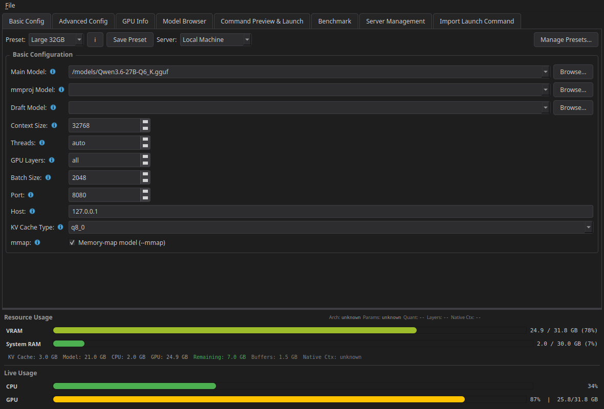
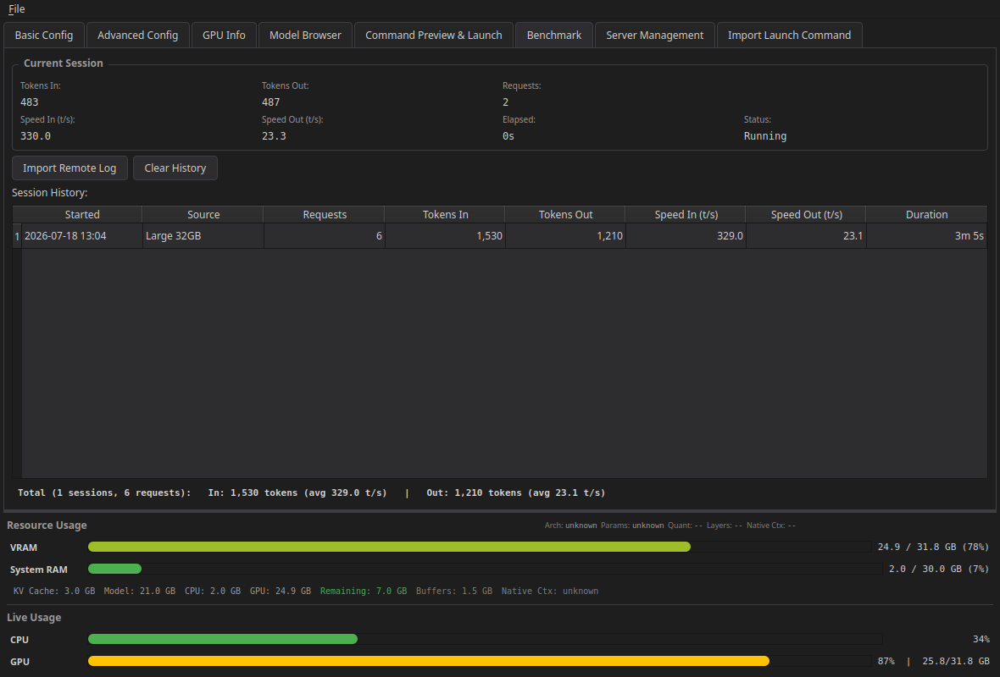
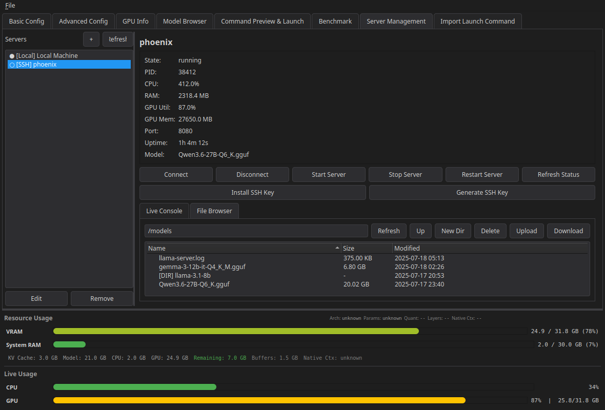
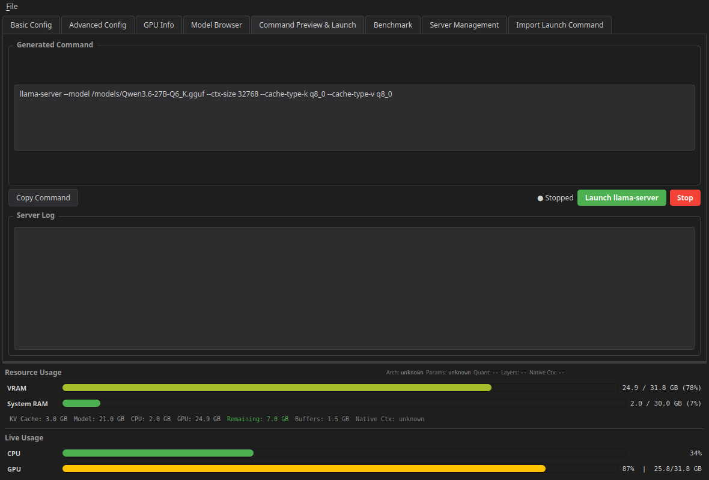

# llama-launcher

A desktop + CLI application that generates, saves, and launches `llama-server` (llama.cpp) configurations.



## Features

- **GUI (PySide6)**: Basic + Advanced configuration tabs (with a parameter search),
  GPU info, model browser, editable command preview & launch, server management
  (local + SSH), benchmark stats, and launch-command import.
- **Verified against llama-server**: every flag in the registry is checked against
  the real binary's `--help`; defaults that llama-server cannot know (context size)
  or that changed between builds (`--jinja`) are always passed explicitly.
- **Chat templates**: paste a Jinja template or a built-in name, load the one
  embedded in the model to edit it, or point at a template file on the server.
- **Config-First Architecture**: every UI action manipulates a shared `LlamaConfig`;
  commands are produced by a single `build_command(config)` and parsed back by `core/parser.py`.
- **GPU Auto-Detection**: NVIDIA (nvidia-smi), AMD (amd-smi / rocm-smi, or the amdgpu
  driver's sysfs files when ROCm is not installed), Apple Metal, Vulkan, with CPU
  fallback. The same probe describes remote hosts over SSH. The GPU Info tab shows
  per-card VRAM, utilization, temperature, power and clocks live, which processes hold
  VRAM, and which llama.cpp build (CUDA / HIP / Vulkan) and build flags to use.
- **Per-server environment**: extra variables for llama-server (e.g.
  `HSA_OVERRIDE_GFX_VERSION=11.0.0` for AMD cards ROCm does not officially support).
- **Resource Estimation**: VRAM/RAM predicted from the GGUF tensor directory and
  architecture metadata, calibrated to within ~1% of llama-server's own
  allocations (dense, MoE, hybrid SSM, partial offload, vision projectors); see
  [docs/ESTIMATOR.md](docs/ESTIMATOR.md). Plus realtime CPU/GPU utilization bars.
- **Benchmark**: parses llama-server logs for tokens/second in/out and token usage,
  per session and in total. Benchmarks are linked to presets (ℹ button next to the
  preset selector) and automatically reset when any parameter changes.
- **Preset System**: built-in presets (Small 8GB, Medium 12GB, Large 32GB) plus custom presets.
- **Remote Servers**: manage llama-server on remote hosts over SSH (status, logs, file
  browser, one-click SSH key install that switches the server to key auth).
- **Structured Logging**: console + rotating log file; no silent failures.

## Installation

The installer creates a virtual environment in `./venv`, installs the application
into it, and registers a desktop entry (Linux):

```bash
git clone <this-repo>
cd llama-launcher
./install.sh            # add --dev for test tooling, --no-desktop to skip the launcher entry
```

Then run:

```bash
./start.sh                       # GUI (uses ./venv)
# or directly:
venv/bin/llama-launcher-gui      # GUI entry point
venv/bin/llama-launcher --help   # CLI entry point
```

Requirements: Python 3.10+ (with `python3-venv` on Debian/Ubuntu), OpenSSH's
`ssh`/`scp` for remote servers, and a `llama-server` binary (from
[llama.cpp](https://github.com/ggml-org/llama.cpp)) either on `PATH` or
configured per-server in Server Management. The flag registry tracks llama.cpp
builds from 2026; much older builds may reject newer flags.
See [docs/SETUP.md](docs/SETUP.md) for the full setup guide (manual install,
remote servers, SSH keys, benchmarking, uninstall).

### Manual installation

```bash
python3 -m venv venv
source venv/bin/activate
pip install .            # or: pip install ".[dev]"
```

## Usage

### GUI

```bash
llama-launcher-gui          # installed entry point
python -m llama_launcher    # from the source checkout (inside the venv)
```

### CLI

```bash
# Detect GPU
llama-launcher detect

# Scan models in a directory
llama-launcher scan /path/to/models

# Show the launch command for a config (dry run)
llama-launcher launch --model model.gguf --context 8192 --gpu-layers 99 --threads 8 --dry-run

# Launch using a saved preset
llama-launcher launch --preset "Small 8GB" --model model.gguf
```

## Screenshots

| | |
|---|---|
|  |  |
| *Benchmark: tokens/sec in/out per session + totals* | *Server Management: status, live log, remote file browser* |
|  | |
| *Command Preview & Launch* | |

## Tests

```bash
python -m pytest
```

## License

MIT, see [LICENSE](LICENSE). Qt/PySide6 is LGPLv3, see
[THIRD-PARTY-NOTICES.md](THIRD-PARTY-NOTICES.md).

## Configuration & Data

Runtime state lives in `~/.config/llama-launcher/` (honors `XDG_CONFIG_HOME`):

- `presets.json` — custom presets (chmod 600, may contain HF tokens)
- `servers.json` — server definitions (chmod 600, contains credentials)
- `models.json` — per-server model scan cache
- `folders.json` — model browser source folders
- `benchmarks.json` — benchmark session history (linked to presets via config fingerprints)
- `logs/` — rotating application logs

Legacy `~/.llama_launcher_*.json` files are migrated automatically on first run.

## Architecture

```
llama_launcher/
├── core/
│   ├── fields.py     # ★ declarative registry for ~180 llama-server parameters
│   ├── config.py     # LlamaConfig schema + legacy preset migration
│   ├── builder.py    # registry-driven command builder (shell-quoted)
│   ├── parser.py     # registry-driven command importer
│   ├── validator.py  # registry-driven validation
│   └── presets.py    # preset storage (built-in + custom)
├── gui/
│   ├── main_window.py       # thin shell: wiring + orchestration
│   ├── config_controller.py # live widget <-> config binding
│   ├── theme.py             # enforced dark theme
│   ├── widgets.py           # shared widgets (BinaryContextSpinBox, info labels)
│   ├── workers.py           # background QThread workers
│   ├── tabs/                # basic, advanced, gpu, models, preview, benchmark, import tabs
│   ├── dialogs/             # preset manager dialog
│   ├── advanced_tab.py      # registry-generated advanced editor
│   ├── server_management.py # local/SSH server management
│   └── resource_usage_panel.py
├── benchmark/     # log timing parser, session storage, config fingerprints
├── gpu/           # GPU auto-detection (CUDA, Metal, Vulkan)
├── estimator/     # GGUF header reader (gguf.py) + calibrated VRAM/RAM estimation
├── models/        # Model filesystem scanner + per-server scan cache
├── remote/        # ServerManager: local (subprocess) and SSH (OpenSSH client) connections
├── cli/           # CLI entry point
├── utils/         # Config dir management, logging setup, helpers
├── app.py         # GUI bootstrap
└── __main__.py    # python -m llama_launcher
```

The **field registry** (`core/fields.py`) is the single source of truth: the
command builder, command parser, validator, advanced-tab editor generation,
and widget bindings are all driven by it. Adding a parameter means adding one
`Field` entry.

## Configuration Flow

```
UI ⇄ ConfigController ⇄ LlamaConfig ⇄ Validator ⇄ Builder ⇄ Command
Command → Parser → LlamaConfig (import)
```

All commands are generated via `build_command(config: LlamaConfig) -> str` and
parsed via `parse_launch_command(command: str) -> (params, unrecognized, duplicates)`.
The GUI never blocks on I/O: scanning, GPU detection, estimation, and all
SSH/SFTP operations run in background workers.
